# TurtleBro · «Ледяной вызов — инспекция»

Автономный робот TurtleBro объезжает поле с четырьмя арматурами (трубопроводами), у каждой
читает **табличку**, номер **ArUco-маркера**, положение стрелки **манометра**, находит
**животное** (медведь / лось) и возвращается на старт. Всё на борту Raspberry Pi 4, без интернета
и без ноутбука во время заезда.

> **Итог финального заезда: все 4 арматуры распознаны, 56 секунд, лучшее время на момент заезда.**

<p align="center">
  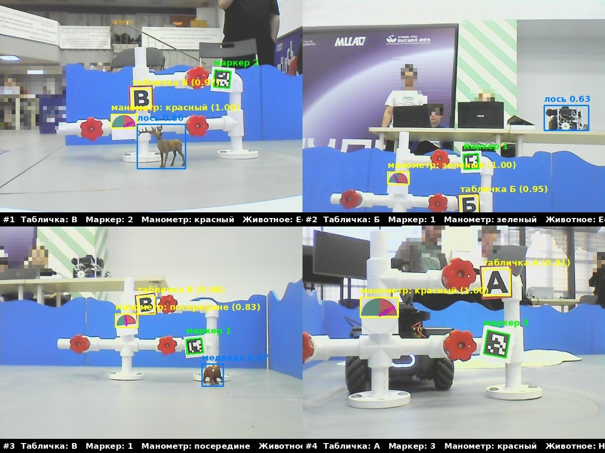
  <br><sub>Сводка, которую робот сам собирает после заезда (logs/run_*/summary.jpg). Лица на фоне размыты.</sub>
</p>

---

## Содержание

- [Задача](#задача)
- [Результат](#результат)
- [Железо](#железо)
- [Как это устроено](#как-это-устроено)
- [Структура репозитория](#структура-репозитория)
- [Установка на робота](#установка-на-робота)
- [Заезд: от записи маршрута до логов](#заезд-от-записи-маршрута-до-логов)
- [Калибровка](#калибровка)
- [Модули подробно](#модули-подробно)
- [Обучение модели животных](#обучение-модели-животных)
- [Грабли и решения](#грабли-и-решения)
- [Лицензия](#лицензия)

---

## Задача

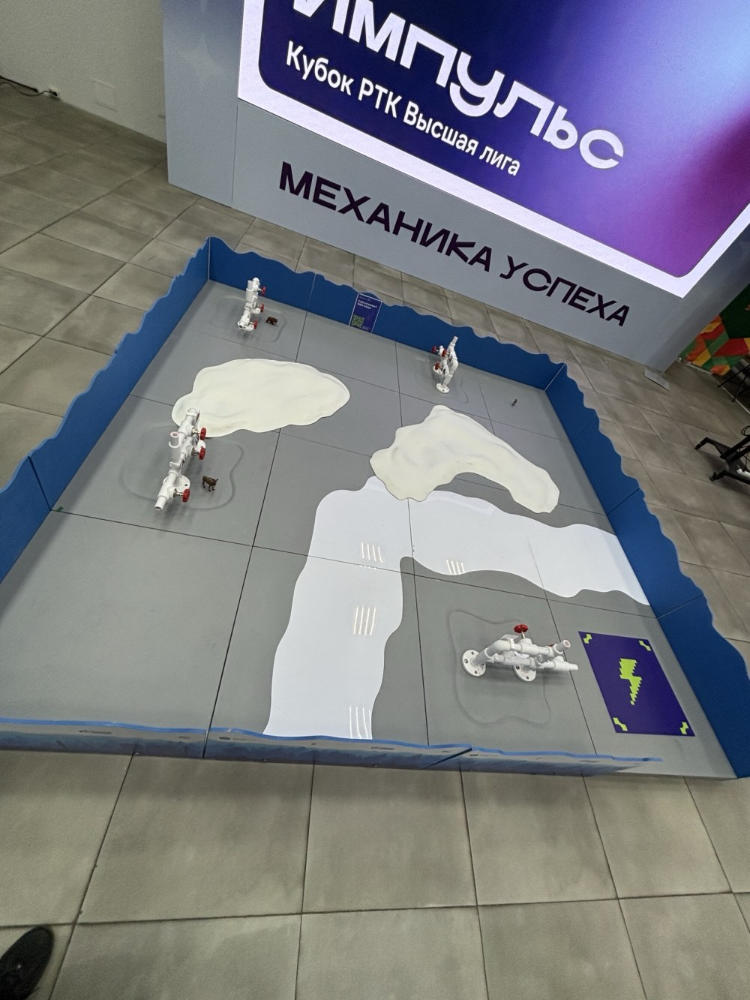

Поле ~3×3 м с синими бортами. На нём:

- **4 арматуры** — белые трубы с вентилями. На каждой:
  - табличка с буквой **А / Б / В**;
  - **ArUco-маркер** (словарь `DICT_6X6_50`);
  - **манометр** — полукруг из зелёного и красного секторов со стрелкой:
    стрелка в зелёном, в красном или **посередине** (на границе);
  - рядом может стоять фигурка **медведя** или **лося** — или никого.
- **Сугробы** — светлые бугры ~5 см высотой (лидар их не видит, он выше).
- **«Лёд»** — плоская белая плёнка на полу, по ней можно ехать.
- **Стартовая зона** — фиолетовый квадрат с молнией; туда же робот должен вернуться.

Робот должен для каждой арматуры вывести в терминал блок строго заданного формата
и сохранить картинку-доказательство:

```
=== Арматура 1 ===
Время: 13:54:24
Табличка: В
Время: 13:54:24
Маркер: 2
Время: 13:54:24
Манометр: красный
Время: 13:54:24
Животное: Есть, Лось
```

Оценивается правильность распознавания и время. Более полное описание — в [docs/task.md](docs/task.md).

<br clear="right">

## Результат

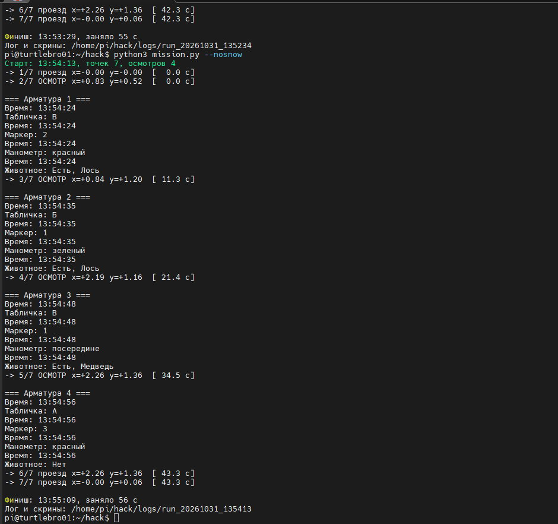

| # | Табличка | Маркер | Манометр | Животное |
|---|---|---|---|---|
| 1 | В | 2 | красный | Есть, Лось |
| 2 | Б | 1 | зеленый | Есть, Лось\* |
| 3 | В | 1 | посередине | Есть, Медведь |
| 4 | А | 3 | красный | Нет |

**Время: 56 с** (лимит регламента — минуты), старт и финиш в одной клетке.

\* На арматуре №2 «лосем» с уверенностью 0.63 оказался **чужой робот на заднем плане**
(видно на сводке сверху справа). После заезда это исправлено двумя фильтрами:
порог уверенности поднят до **0.75**, и животное засчитывается только если **низ рамки стоит на полу**
(в нижних 35 % кадра) — фигурки всегда стоят у основания арматуры, а люди и роботы на фоне «висят» выше.

<br clear="right">

<p align="center">
  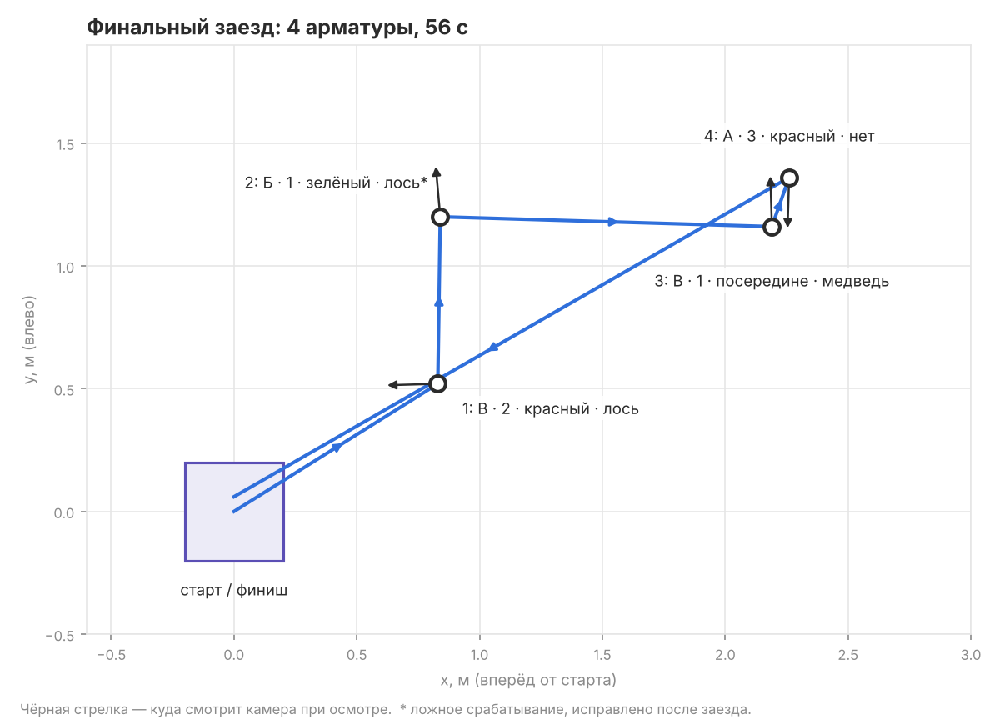
</p>

## Железо

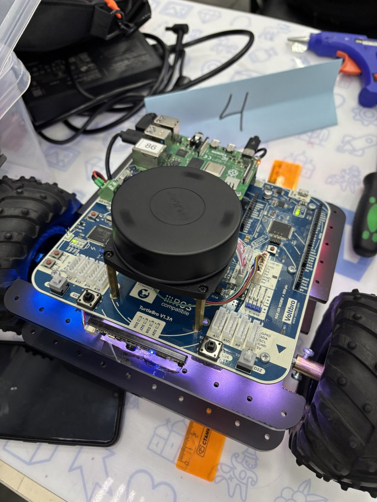

- **TurtleBro** (Voltbro), образ `turtlebro_v2.16`, **ROS 2 Jazzy**.
- Raspberry Pi 4 — вся обработка на борту.
- Лидар (`/scan`), колёсная одометрия (`/odom`), IMU (`/imu`), фронтальная камера
  (`/front_camera/image_raw/compressed`).
- Перед финалом поставили **колёса большего диаметра**: робот просто переезжает сугробы,
  поэтому финальный заезд — в режиме `--nosnow` (без объезда), а коэффициент пути подобран
  через `calib.py dist`.

Скорость при этом — около 0.26 м/с по прямой, 1.5 рад/с на поворотах.

<br clear="right">

## Как это устроено

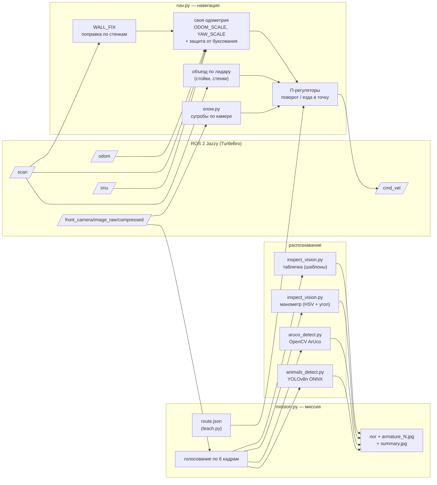

Ход миссии:

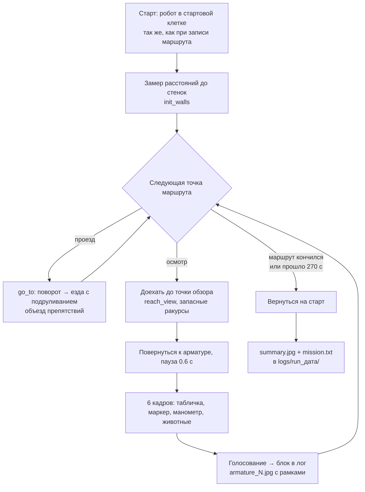

## Структура репозитория

```
robot/                         ← всё это копируется на робота в ~/hack
  mission.py                   заезд: маршрут + распознавание + логи
  nav.py                       навигация, одометрия, объезд, застревание, поправка по стенкам
  teach.py                     запись маршрута с клавиатуры → route.json
  calib.py                     калибровка пути и поворота → local_settings.json
  inspect_vision.py            табличка и манометр (OpenCV, без нейросетей)
  aruco_detect.py              ArUco-маркеры
  animals_detect.py            YOLOv8 ONNX — медведь / лось
  snow.py                      детектор сугробов по камере
  collect.py                   сбор кадров для датасета
  speedtest.py                 замер максимальной скорости
  route.example.json           пример маршрута
  local_settings.example.json  пример локальных настроек (калибровка)
  requirements.txt
training/
  train.py                     обучение YOLOv8n в Colab, экспорт в ONNX
  make_plate_templates.py      генерация шаблонов букв для табличек
  requirements.txt
models/                        сюда кладётся best_v2.onnx (в git не входит, см. models/README.md)
extras/                        запуск без SSH: кнопкой Arduino или ладонью перед лидаром
                               (экспериментально, на соревнованиях не использовалось)
docs/
  task.md                      задача и формат вывода
  algorithms.md                как работают алгоритмы, с цифрами
  cheatsheet.md                шпаргалка команд на соревнованиях
  img/                         картинки для README
  tools/plot_route.py          рисует docs/img/route_plot.png
```

## Установка на робота

На роботе уже стоят ROS 2, OpenCV (`python3-opencv`), numpy. Нужно доставить onnxruntime и Pillow:

```bash
pip install onnxruntime pillow --break-system-packages
```

Скопировать код (с ноутбука, из корня репозитория):

```bash
scp robot/*.py robot/*.example.json pi@<IP-робота>:~/hack/
scp models/best_v2.onnx pi@<IP-робота>:~/hack/
```

Или через левую панель MobaXterm — перетащить файлы в `~/hack`.

На роботе создать свои настройки из примера (один раз):

```bash
cd ~/hack
cp local_settings.example.json local_settings.json   # потом поправить под своего робота (см. «Калибровка»)
```

> `local_settings.json` и `route.json` — **локальные** файлы робота. Обновление кода их не трогает,
> поэтому калибровка не слетает, когда копируете новые `.py`.

## Заезд: от записи маршрута до логов

**1. Записать маршрут** (один раз на поле). Робот ставится в стартовую клетку, ведём его с клавиатуры:

```bash
cd ~/hack && python3 teach.py
```

| Клавиша | Действие |
|---|---|
| `w` `s` `a` `d` | вперёд / назад / влево / вправо (едет, пока не нажмёшь другую) |
| пробел | стоп |
| `+` `-` | быстрее / медленнее |
| `p` | точка проезда (обход, поворот маршрута) |
| `i` | **точка осмотра** — робот смотрит на арматуру с ~40–50 см |
| `u` | удалить последнюю точку |
| `q` | сохранить `route.json` и выйти |

Последней точкой ставится `p` в стартовой клетке — туда робот вернётся. Пример — `robot/route.example.json`.

**2. Проверить без распознавания** (только маршрут):

```bash
python3 mission.py --dry
```

**3. Боевой заезд.** Запуск через `nohup`, чтобы обрыв Wi-Fi/SSH не остановил робота:

```bash
cd ~/hack && nohup python3 mission.py --nosnow > mission_out.log 2>&1 &
tail -f mission_out.log          # смотреть лог (Ctrl+C закрывает только просмотр)
```

| Флаг | Что делает |
|---|---|
| *(без флагов)* | распознавание + объезд сугробов по камере |
| `--nosnow` | сугробы не объезжать (большие колёса их переезжают); стенки и стойки — по лидару |
| `--direct` | ехать только по точкам осмотра и финишу, без промежуточных точек проезда |
| `--dry` | только проезд маршрута, без распознавания |

**Аварийный стоп:**

```bash
pkill -f mission.py
ros2 topic pub --once /cmd_vel geometry_msgs/msg/Twist "{}"
```

**4. Результаты** — в отдельной папке на каждый заезд:

```
~/hack/logs/run_20261031_135413/
  mission.txt        лог в формате регламента
  armature_1.jpg …   кадр каждой арматуры с рамками и уверенностями
  summary.jpg        сводка 2×2
  raw/               исходные кадры без рамок
```

<p align="center">
  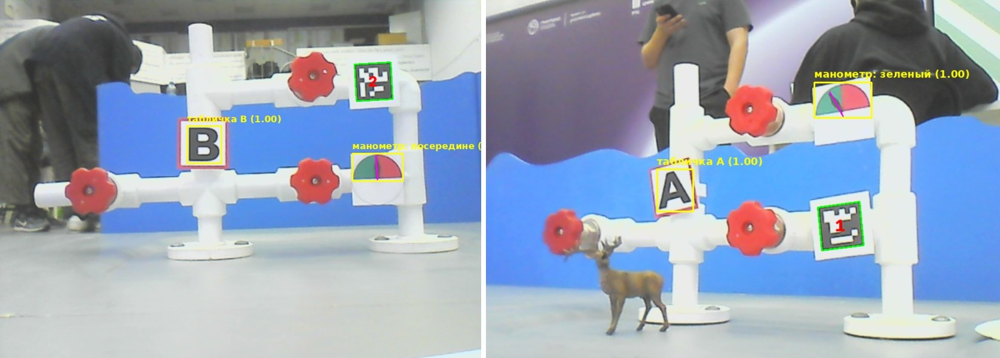
  <br><sub>Табличка (жёлтая рамка + уверенность), ArUco-маркер (зелёная), манометр со стрелкой (фиолетовая линия).</sub>
</p>

## Калибровка

Все поправки живут в `~/hack/local_settings.json` — их подхватывают `nav.py`, `snow.py`,
`inspect_vision.py` и `mission.py`. Любую константу из кода можно переопределить тут же.

```json
{
  "LIDAR_FRONT_DEG": 180.0,
  "LIDAR_DIR": 1,
  "TRIGGER_Y": 0.85,
  "ODOM_SCALE": 1.0,
  "YAW_SCALE": 1.0,
  "MAX_LIN": 0.26,
  "MAX_ANG": 1.5
}
```

| Ключ | Что это | Как подобрать |
|---|---|---|
| `LIDAR_FRONT_DEG` | «сырой» угол лидара, который смотрит вперёд | `python3 nav.py scan`, поставить ладонь перед носом — где расстояние меньше, там перёд. У нашего робота лидар был развёрнут на **180°** |
| `LIDAR_DIR` | `-1`, если лево/право перепутаны | ладонь слева → в `nav.py scan` должно уменьшиться «СЛЕВА» |
| `ODOM_SCALE` | реальный путь / путь по колёсам | `python3 calib.py dist` — проедет 0.8 м и спросит, сколько вышло на самом деле |
| `YAW_SCALE` | реальный поворот / по одометрии | `python3 calib.py rot` — 4 поворота по 90° |
| `TRIGGER_Y` | где по высоте кадра срабатывает объезд сугроба | `python3 snow.py --ros`, край сугроба в ~25 см от носа, взять «ближний край y=…» |
| `MAX_LIN`, `MAX_ANG` | потолок скорости | `python3 speedtest.py` (колёса в воздухе) и `speedtest.py rot` |
| `ANIMAL_CONF` | порог уверенности для животных | по умолчанию 0.75 |
| `PLATE_MIN_SCORE` | порог уверенности для табличек | по умолчанию 0.75 |

Проверки навигации:

```bash
python3 nav.py pose          # x, y, курс, наклон
python3 nav.py scan          # СПЕРЕДИ / СЛЕВА / СПРАВА / СЗАДИ
python3 nav.py rot 90        # поворот на 90° влево
python3 nav.py fwd 0.5       # 0.5 м вперёд
python3 nav.py square 0.5    # квадрат и ошибка возврата
python3 calib.py show        # что записано в local_settings.json
```

Без рулетки: лист A4 — 29.7 см, три листа длинной стороной — 89 см.

## Модули подробно

Кратко — ниже, с цифрами и обоснованиями — в [docs/algorithms.md](docs/algorithms.md).

**Табличка** (`inspect_vision.py`). Ищем тёмные связные области на белом поле таблички,
вырезаем символ, нормализуем до 32×32 и сравниваем корреляцией с шаблонами (шрифты +
реальные вырезки с поля). Перебираем наклон ±15° и растяжение по ширине ×1.0/1.3/1.6
(при взгляде сбоку буква сжата). Алфавит ограничен регламентом — `АБВ`. Б и В различаются
отдельной проверкой «есть ли чернила справа вверху». Рамки маркера и манометра исключаются,
чтобы не путать их с табличкой.

**Манометр** (`inspect_vision.py`). В HSV выделяем зелёный и красный секторы, по ним находим
полукруг, центр оси и радиус. Угол стрелки сравнивается с углом границы цветов:
ближе 7° к границе — **«посередине»**, иначе цвет сектора под стрелкой.

**ArUco** (`aruco_detect.py`). OpenCV, словарь `DICT_6X6_50` (определён автоподбором на первой
тренировке). Совместим со старым и новым API OpenCV. Маркеры мельче 4 % ширины кадра — чужие
арматуры вдали, их игнорируем.

**Животные** (`animals_detect.py`). YOLOv8n, вход 320×320, ONNX через onnxruntime на CPU
Raspberry Pi — ~250 мс на кадр. Свой NMS. Классы: `bear`, `elk`.

**Голосование** (`mission.py`). На точке осмотра — 6 кадров. Табличка, маркер, манометр —
самый частый ответ. Животное «есть», если найдено хотя бы на 40 % кадров, вид — по большинству.

**Навигация** (`nav.py`).
- Своя интеграция одометрии с коэффициентами `ODOM_SCALE` / `YAW_SCALE`.
- **SLIP_GUARD**: если колёса насчитали ≥5 см, а скан лидара почти не изменился — робот
  буксует (застрял в сугробе), путь не засчитывается.
- **WALL_FIX**: на старте запоминаем расстояния до стенок; перед каждой точкой сверяем
  с текущими и поправляем координаты (если две противоположные стенки согласны).
- Объезд стоек и стенок по лидару: проверяется полоса шириной робота, сторона объезда
  выбирается по свободному месту, после 3 неудач — пробуем другую.
- Застревание: окно 1.2 с без движения или наклон по IMU >5° → отъезд и объезд.

**Сугробы** (`snow.py`). Лидар 5-сантиметровые сугробы не видит. По камере ищем пятна,
которые ярче пола и почти без цвета, при этом: широкие и низкие, лежат на полу,
между ними и полом нет синего борта, и снизу есть тёмная кромка (у «льда» её нет).

<p align="center">
  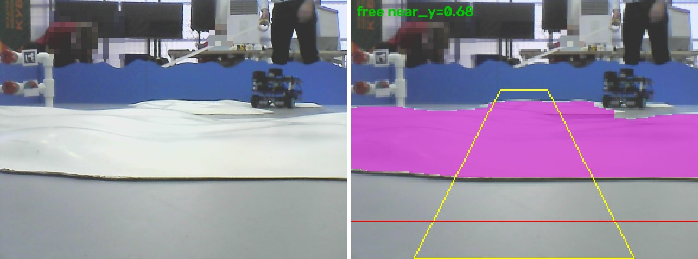
  <br><sub>Слева кадр камеры, справа — найденный сугроб (фиолетовый), коридор движения (жёлтый) и линия срабатывания (красная).</sub>
</p>

## Обучение модели животных

1. Кадры с камеры робота: `python3 collect.py 0.5 bear` (папка `~/hack/frames`).
2. Разметка в Roboflow, два класса: `bear`, `elk`.
3. Обучение в Google Colab:

```bash
pip install -r training/requirements.txt
export ROBOFLOW_API_KEY=...          # свой ключ из настроек Roboflow
export ROBOFLOW_VERSION=2
python training/train.py             # → best_v2.onnx
```

4. Положить `best_v2.onnx` в `~/hack` на роботе.

Результаты обучения версии 2 (YOLOv8n, 320×320):

<p align="center">
  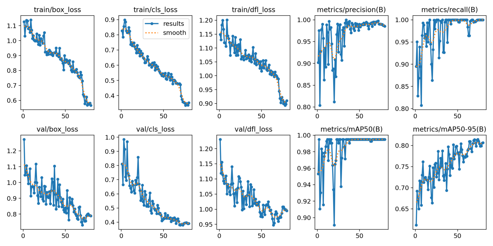
</p>
<p align="center">
  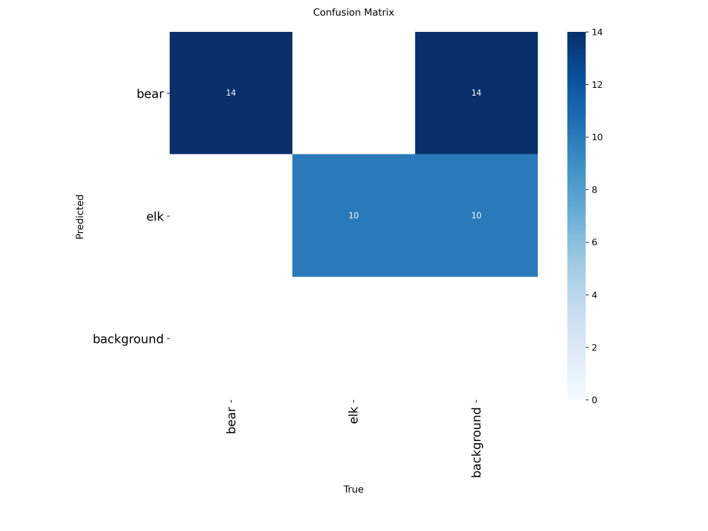
  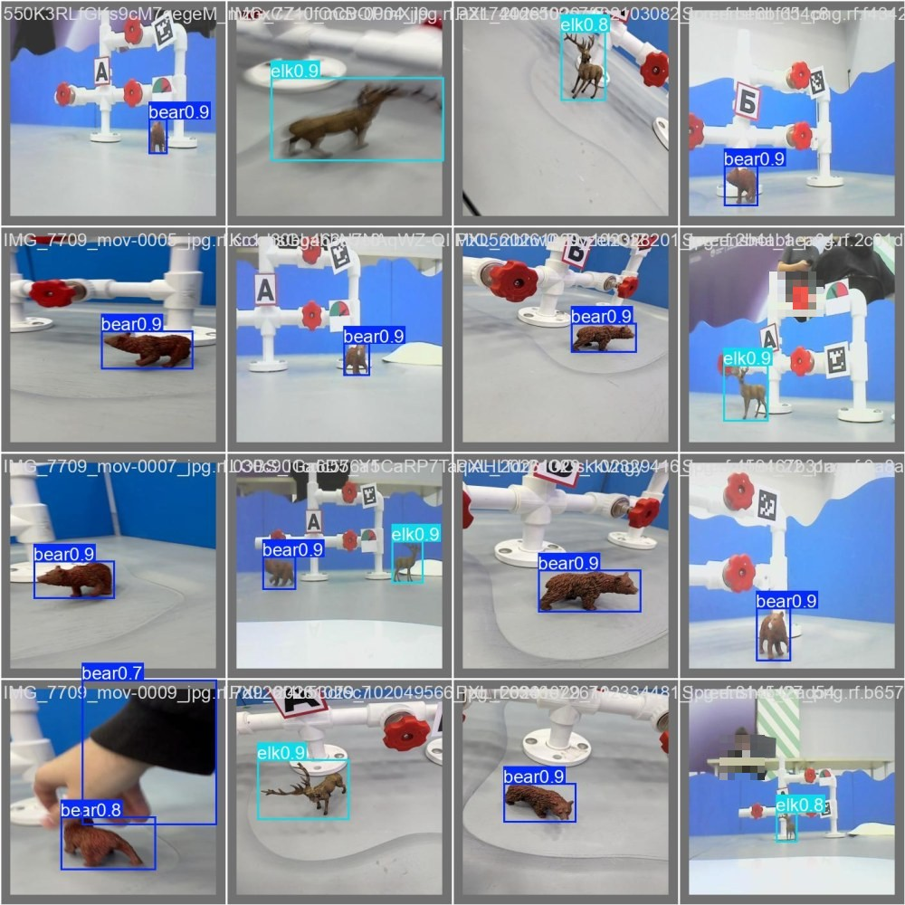
</p>

## Грабли и решения

| Проблема | Решение |
|---|---|
| После обновления `nav.py` робот поехал в стену — слетела калибровка лидара | Все поправки вынесены в `local_settings.json`, который код не перезаписывает |
| Лидар установлен задом наперёд | `LIDAR_FRONT_DEG = 180`, `nav.py scan` с подписями СПЕРЕДИ/СЛЕВА/… |
| Детектор сугробов ломался при другом свете (сугроб «белый», а не «кремовый») | Режим `white`: яркость относительно пола + форма + кромка вместо оттенка |
| Трубы арматуры и белый борт принимались за сугроб | Фильтры по форме (широкий и низкий), «лежит на полу», нет синего борта в зазоре |
| Буксование в сугробе сбивало координаты | `SLIP_GUARD` (сравнение со сканом лидара) + `WALL_FIX` (поправка по стенкам) |
| `terminate called without an active exception` при выходе | Свой цикл `spin_once` в фоне и аккуратный `close()` |
| Робот на фоне распознан как лось (0.63) | Порог 0.75 + «животное стоит на полу» |
| Обрыв SSH останавливал заезд | Запуск через `nohup … &` |
| MobaXterm портил вставку многострочных команд | `echo 'set enable-bracketed-paste off' >> ~/.inputrc` |

Шпаргалка команд, которой пользовались на соревнованиях, — [docs/cheatsheet.md](docs/cheatsheet.md).

## Лицензия

[MIT](LICENSE).
