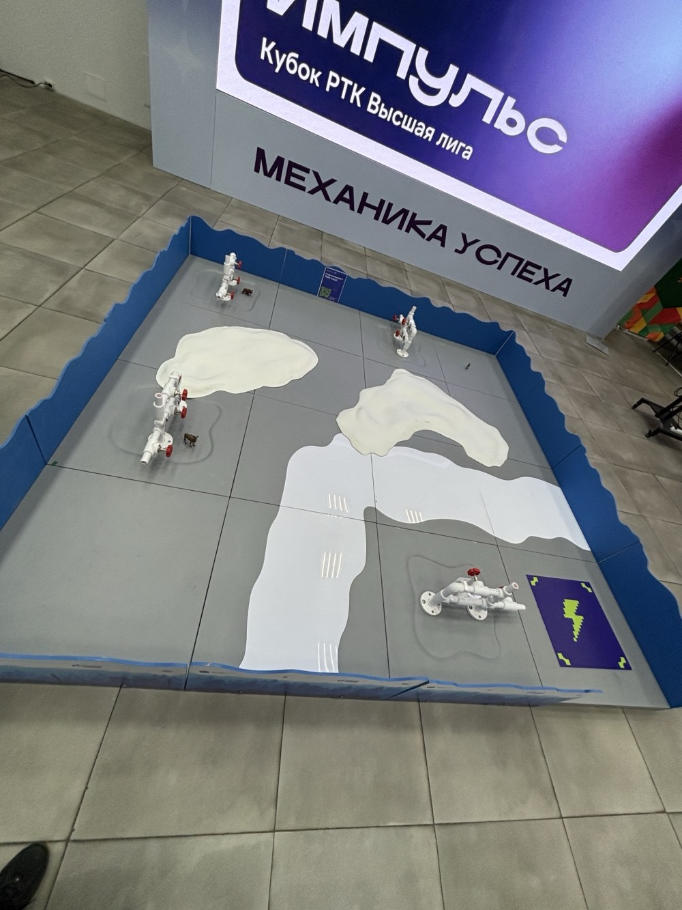
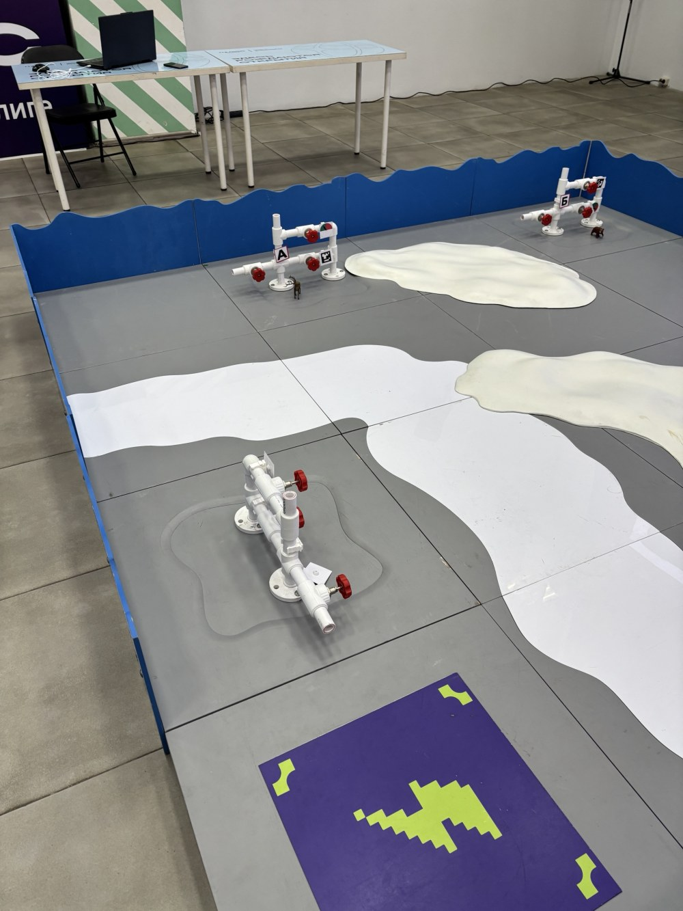

# Задача: «Ледяной вызов — инспекция»

Кратко пересказано по регламенту — точные правила и баллы смотрите в официальном регламенте соревнований.

## Поле



- Площадка ~3×3 м с синими волнистыми бортами, пол — серая плитка.
- **Стартовая зона** — фиолетовый квадрат с молнией. Финиш — там же.
- **4 арматуры** — белые трубы с красными вентилями на фланцах.
- **Сугробы** — светлые бугры ~5 см высотой. Лидар робота стоит выше и их не видит.
- **«Лёд»** — плоская белая плёнка на полу. Проезжаема.
- **Животные** — фигурки медведя и лося у основания некоторых арматур.



## Что нужно распознать на каждой арматуре

| Объект | Варианты | Как распознаём |
|---|---|---|
| Табличка | А, Б, В | шаблоны букв, OpenCV |
| ArUco-маркер | номер (словарь `DICT_6X6_50`) | OpenCV `aruco` |
| Манометр | красный / зеленый / посередине | цвет сектора под стрелкой |
| Животное | Нет / Есть, Медведь / Есть, Лось | YOLOv8n (ONNX) |

## Формат вывода

Для каждой арматуры в терминал (и в `mission.txt`):

```
=== Арматура N ===
Время: ЧЧ:ММ:СС
Табличка: <А|Б|В>
Время: ЧЧ:ММ:СС
Маркер: <id>
Время: ЧЧ:ММ:СС
Манометр: <красный|зеленый|посередине>
Время: ЧЧ:ММ:СС
Животное: <Нет|Есть, Медведь|Есть, Лось>
```

Плюс картинка каждой арматуры с рамками — доказательство для судей (`armature_N.jpg`, `summary.jpg`).

## Порядок заезда

1. Робот ставится в стартовую зону.
2. Старт — дальше только автономно.
3. Робот объезжает арматуры, выводит результаты, возвращается в стартовую зону.
4. Учитываются правильность распознавания и время. В коде стоит страховка `TIME_LIMIT = 270` с —
   после неё оставшиеся осмотры пропускаются и робот едет на финиш.
